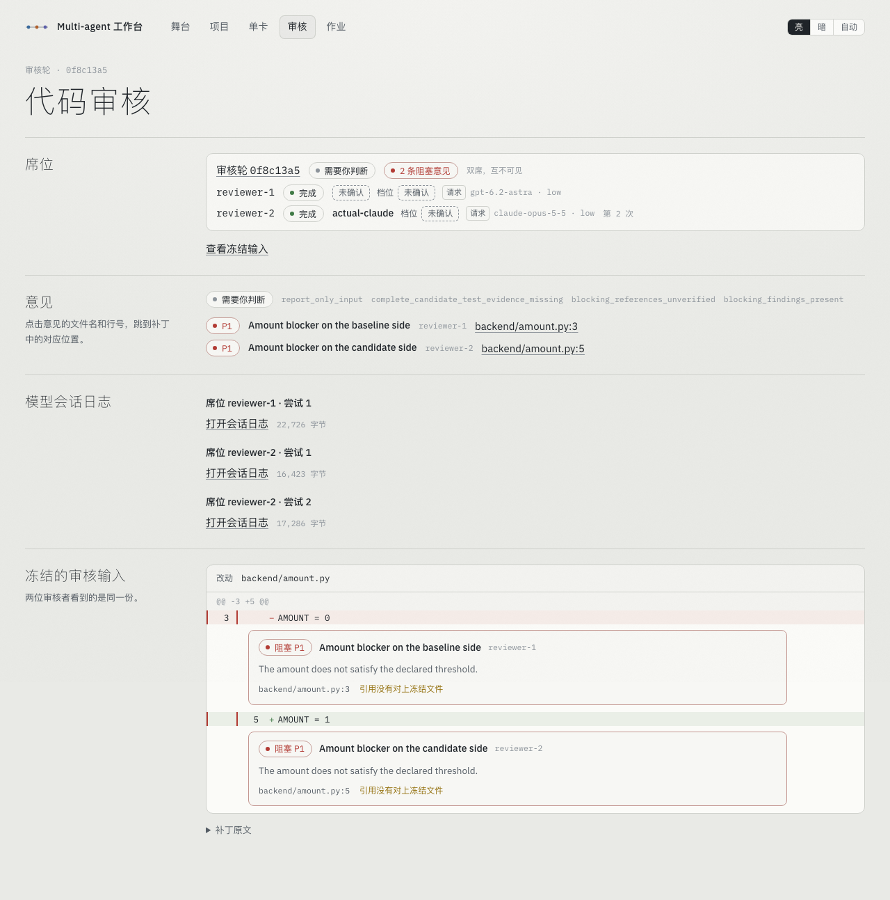

# Multi-agents

Multi-agents is a local macOS workbench that coordinates Codex and Claude Code through their existing CLI logins. You can plan a project with both models, assign implementation to separate Git worktrees, and inspect each candidate commit alongside its tests and independent code reviews. One service instance manages one repository for one user. The web interface is in Chinese.

[Explore the offline demo](#explore-the-recorded-demo) · [Trace a browser action through the code](#how-a-browser-action-reaches-a-model) · [Run the test suite](#verification)

## Follow a change from request to acceptance

**Example.** A reporting feature needs a backend amount and a frontend summary. The summary must show `ready` when the amount is available. The offline demo includes a candidate that passes the registered tests while still displaying `draft`.

1. **Plan and assign.** You confirm the goal after consultation. The planner makes the summary stage depend on the amount stage. A stage can have one implementer or be split into smaller tasks. In this example, the repository rules assign the backend file to Codex and the frontend files to Claude Code.
2. **Freeze and test.** The workbench combines the completed tasks into a Git candidate and runs the project's registered `build` and `test` commands in a separate checkout. It freezes the diff, requirements, and test evidence together. The example test checks that the output can be built and read. It accepts both `draft` and `ready`, so a green run still leaves a requirement for review.
3. **Review the exact change.** Select one reviewer or two independent reviewers. In a dual review, both models see the same frozen input and their findings are combined after both reports arrive. In the example, the reviewer quotes the `draft` value at `frontend/status.js:1`. Opening the finding takes you to that line in the reviewed commit.
4. **Repair and accept.** With automatic rework enabled, a verified blocker attributable to one task can trigger one repair cycle. The revised candidate runs the original full test suite again. Once it passes, the original reviewers receive a new snapshot. When you explicitly accept, the workbench rechecks the candidate and target refs and records the commit, test evidence, and review round in a receipt. Merging into the target branch is a separate Git operation.

The recorded rework scenario lets you initiate that repair yourself. Its Chromium regression checks the frozen line, the change between the two candidates, and the final receipt after a page reload. [Recorded scenarios](docs/web-api/samples/README.md) · [Browser regression](frontend/e2e/rework.spec.ts)

## How a browser action reaches a model

| Layer | What happens |
| --- | --- |
| React and TypeScript | The browser sends an action and its arguments to `POST /api/jobs`, receives a job ID, and polls for completion. It loads the resulting diff, frozen file, or log by resource ID. [Typed client](frontend/src/api/client.ts) |
| Local HTTP service and Python CLI | The service listens on `127.0.0.1` and serves the UI and API from the same origin. It validates workflow actions and builds an argument list for the same Python CLI available in the terminal. The job controller owns the subprocess and records its exit status. [Action translation](src/multi_agent/web/actions.py) · [Job controller](src/multi_agent/web/jobs.py) |
| Provider adapters | Codex uses its local App Server over JSON-RPC. Claude Code runs as a headless subprocess with streaming JSON output. Adapters translate provider events into workbench events. The UI distinguishes the requested model and reasoning level from the runtime's report. Missing evidence is marked unconfirmed. [Runtime adapter](src/multi_agent/adapters/runtime.py) |
| Git and SQLite | Git fixes the source tree for each candidate. SQLite associates each attempt, snapshot, and review round with its evidence. A late response is retained in history while the current attempt controls progress. If the target branch moves, a new candidate must pass testing and review before acceptance. [State transitions](src/multi_agent/core/transitions.py) · [Acceptance checks](src/multi_agent/cli/integration_verification.py) |

Two implementation details matter when several models work on the same repository.

- **Parallel writes.** Dispatch reads the rules from the baseline commit, intersects the task's declared paths with the allowed model and provider choices, and rejects protected paths. Independent tasks can run in separate worktrees. Before integration, the host checks each actual candidate diff against the task's write scope. [Dispatch rules](src/multi_agent/core/dispatch.py) · [Candidate checks](src/multi_agent/cli/task_candidates.py)
- **Retries and late results.** A review seat has numbered attempts. The store reads the current state and applies an event in one SQLite transaction. A response from an earlier attempt remains available as history and cannot complete its replacement. A failed seat can be retried against the same snapshot while the other seat's completed report stays in place. [Review store](src/multi_agent/store/database.py) · [State transitions](src/multi_agent/core/transitions.py)

### What a reviewer sees

This screenshot comes from a Chromium run against the local service with simulated model responses. Two independent reviewers annotate different lines of the same frozen patch. Each finding links to the baseline or candidate line it refers to.

<a href="docs/images/workbench.png"></a>

## Quick start

### Explore the recorded demo

Use Node.js 24.15 or later in the 24.x series with Corepack. The frontend pins pnpm 10.34.9. This demo replays saved HTTP responses and needs no provider login or model calls.

```sh
git clone https://github.com/Owenqi666/multi-agents.git
cd multi-agents
(cd frontend && corepack pnpm install --frozen-lockfile && corepack pnpm mock)
```

Open the local URL printed by Vite. The default scenario runs through acceptance. Add `?mock=rework` to explore the review finding and revised candidate. Other recordings cover partial dual review and cancellation.

### Run against your own repository

Install Git, Python 3.12 or later, and uv. Sign in to each provider CLI you want to use. From the workbench source directory, install the dependencies and build the web interface.

```sh
uv sync --frozen
(cd frontend && corepack pnpm install --frozen-lockfile && corepack pnpm build)

REPO="/absolute/path/to/your-project"
DATA="$HOME/.local/share/multi-agents/my-project"
uv run python -m multi_agent.web --repository "$REPO" --data-dir "$DATA" --port 0
```

Open the loopback address printed by the Python service. Choose a target repository with at least one commit and a private data directory outside the target and its worktrees. Before planning or implementing a change, commit the project's path rules and named tests to `.multi-agent/rules.yaml` on the baseline you intend to use. [Workbench guide](docs/workbench.md)

## Verification

From the workbench source directory, run the Python checks, frontend checks, and Chromium suite separately.

```sh
scripts/verify.sh
(cd frontend && corepack pnpm run check)
(cd frontend && corepack pnpm exec playwright install chromium && corepack pnpm run e2e)
```

The Python gate covers Ruff, formatting, mypy, unit tests, and event replay. Frontend checks cover TypeScript, ESLint, and component tests. The Chromium suite exercises the real local service, CLI, Git, and SQLite with scripted provider responses. It tests orchestration behavior independently of model quality. [Python gate](scripts/verify.sh) · [Integration test for acceptance and retries](tests/unit/test_integration_verification_cli.py)
